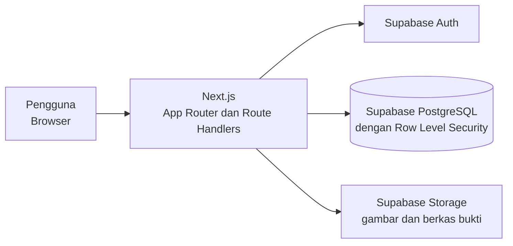

# Ada Apa Dengan Konsol (AADK)


---

`AADK` adalah website pusat informasi panduan perbaikan dan perawatan konsol game (PlayStation, Xbox, dan Nintendo), dilengkapi forum diskusi yang dimoderasi. Panduan disusun oleh teknisi terverifikasi agar pengguna memperoleh acuan yang jelas, konsisten, dan mudah dipahami.

Proyek ini dikembangkan secara individu sebagai proyek *Project Based Learning* pada Kompetensi Keahlian Rekayasa Perangkat Lunak, Semester Genap 2025/2026.

# Contents

- [Latar Belakang dan Tujuan](#latar-belakang-dan-tujuan)
- [Fitur](#fitur)
- [Peran Pengguna](#peran-pengguna)
- [Arsitektur](#arsitektur)
- [Teknologi](#teknologi)
- [Menjalankan Proyek](#menjalankan-proyek)
  - [Prasyarat](#prasyarat)
  - [Instalasi](#instalasi)
  - [Konfigurasi](#konfigurasi)
  - [Menyiapkan Basis Data](#menyiapkan-basis-data)
  - [Menjalankan Aplikasi](#menjalankan-aplikasi)
- [Struktur Basis Data](#struktur-basis-data)
- [Keamanan](#keamanan)
- [Struktur Folder](#struktur-folder)
- [Dokumentasi Perancangan](#dokumentasi-perancangan)
- [Status dan Keterbatasan](#status-dan-keterbatasan)
- [Rencana Pengembangan](#rencana-pengembangan)
- [Kontribusi dan Pengembang](#kontribusi-dan-pengembang)
- [Referensi dan Kredit](#referensi-dan-kredit)
- [Lisensi](#lisensi)

### Latar Belakang dan Tujuan

---

Pengguna konsol game sering kesulitan ketika perangkatnya rusak. Panduan perbaikan di internet tersebar di banyak tempat, memberikan jawaban yang berbeda-beda, dan kerap saling bertentangan. Akibatnya, pengguna sulit menentukan penyebab kerusakan, ragu memilih langkah perbaikan yang benar, dan berisiko memperparah kerusakan karena penanganan yang kurang tepat.

AADK dibuat untuk:

- Menyediakan pusat informasi tutorial perbaikan dan perawatan perangkat konsol game.
- Membantu pengguna menemukan panduan yang sesuai berdasarkan merek, tipe, dan model konsol.
- Menyajikan panduan dengan bahasa yang jelas, langkah-langkah rinci, dan peringatan keselamatan.
- Menyediakan forum diskusi agar pengguna dapat berbagi pengalaman dan solusi.

### Fitur

---

**Pengunjung dan pengguna**

- Memilih konsol berdasarkan merek, tipe, tahun rilis, dan model, dengan pencarian dan filter
- Membaca tutorial: alat dan bahan, peringatan, dan langkah-langkah bergambar
- Registrasi bertahap dan login
- Komentar pada tutorial
- Forum: membuat, mengedit, dan menghapus postingan, membalas, menyukai, dan melaporkan konten
- Profil dan dashboard pribadi: riwayat membaca tutorial, postingan dan komentar yang dibuat
- Pilihan bahasa (Indonesia dan Inggris)

**Teknisi terverifikasi**

- Mengajukan diri sebagai teknisi dengan bukti pendukung
- Membuat, mengedit, dan menghapus tutorial milik sendiri
- Melihat riwayat tutorial yang dibuat

**Moderator**

- Meninjau laporan pelanggaran, menghapus konten yang melanggar, dan memberi peringatan
- Meninjau pengajuan teknisi

**Super Admin**

- Mengelola data konsol dan model konsol
- Mengelola data pengguna dan moderator
- Dashboard statistik dengan grafik

### Peran Pengguna

---

| Peran | Hak akses |
| --- | --- |
| **Guest** | Melihat konsol, membaca tutorial, melihat forum, registrasi, dan login |
| **Anggota** | Hak Guest, ditambah komentar, forum (posting, balas, suka, lapor), profil, dan riwayat |
| **Teknisi** | Hak Anggota, ditambah membuat dan mengelola tutorial milik sendiri |
| **Moderator** | Meninjau laporan, menghapus konten, memberi peringatan, dan meninjau pengajuan teknisi |
| **Super Admin** | Mengelola data konsol, pengguna, dan moderator |

### Arsitektur

---



### Teknologi

---

| Teknologi | Peran |
| --- | --- |
| Next.js (App Router) | Kerangka kerja web, perutean, dan Route Handlers |
| React dan TypeScript | Antarmuka berbasis komponen dengan pengetikan statis |
| Tailwind CSS | Penataan gaya |
| Supabase | Authentication, basis data PostgreSQL, dan Storage |
| next-intl | Dukungan multi-bahasa |
| Recharts | Grafik pada dashboard |
| Figma | Perancangan antarmuka |
| Git dan GitHub | Pengelolaan versi |
| Visual Studio Code | Lingkungan pengembangan |

### Menjalankan Proyek

---

#### Prasyarat

- [Node.js](https://nodejs.org) versi 24.15.0
- Pengelola paket npm versi 12.1.0
- Database [Supabase](https://supabase.com)
  
#### Instalasi

```bash
$ git clone https://github.com/RizzaHut/PJBL-AADK.git
$ cd PJBL-AADK
$ npm install
```

#### Konfigurasi

Salin berkas contoh lalu isi dengan nilai dari proyek Supabase Anda (Project Settings, API):

```bash
$ cp .env.example .env.local
```

| Variabel | Keterangan |
| --- | --- |
| `NEXT_PUBLIC_SUPABASE_URL` | URL proyek Supabase |
| `NEXT_PUBLIC_SUPABASE_ANON_KEY` | Kunci publik (anon) Supabase |
| `SUPABASE_SERVICE_ROLE_KEY` | Kunci service role |

#### Menyiapkan Basis Data

1. Buka **SQL Editor** pada proyek Supabase Anda.
2. Jalankan semua berkas migrasi di `supabase/migrations/` secara berurutan untuk membuat tabel, tipe enum, trigger, kebijakan RLS, dan bucket storage. Jika database sudah memakai migrasi sebelum `20261027101917_login_account_lookup.sql`, jalankan migrasi baru itu juga agar pencarian username login memiliki izin server yang diperlukan.
3. Pada proyek Supabase baru, hak akses tabel untuk peran `anon` dan `authenticated` tidak lagi diberikan otomatis. Pastikan pernyataan `GRANT` yang diperlukan ikut dijalankan.
4. Buat akun Super Admin pertama.
5. Isi data awal konsol dan model konsol melalui dashboard Super Admin.

#### Menjalankan Aplikasi

```bash
$ npm run dev
```

Buka `http://localhost:3000` pada browser.

Untuk membuat versi produksi:

```bash
$ npm run build
$ npm start
```

### Struktur Basis Data

---

Basis data menggunakan PostgreSQL (Supabase) dengan penamaan tabel dan kolom berbahasa Indonesia.

| Kelompok | Tabel |
| --- | --- |
| Akun | `pengguna` (anggota dan teknisi), `staf` (moderator dan super admin), `pengajuan_teknisi` |
| Konsol | `konsol`, `model_konsol` |
| Tutorial | `tutorial`, `langkah_tutorial`, `komentar_tutorial`, `baca_tutorial` |
| Forum | `postingan_forum`, `komentar_forum`, `suka_postingan`, `baca_postingan` |
| Moderasi | `laporan`, `peringatan` |

### Keamanan

---

- **Row Level Security (RLS)** aktif pada seluruh tabel. Konten publik dapat dibaca semua orang, sedangkan tabel privat dibatasi untuk pemilik dan staf.
- Hanya pengguna berperan teknisi yang dapat menjadi penulis tutorial, dan hal ini dijamin di tingkat basis data melalui RLS.
- Penyimpanan berkas terbagi menjadi beberapa bucket dengan akses baca dan tulis yang berbeda, misalnya berkas bukti verifikasi teknisi bersifat privat.
- Kata sandi dikelola Supabase Auth dan disimpan terenkripsi.

### Struktur Folder

---

```shell
aadk/
├── src/
├───app
│   ├───api
│   │   ├───admin
│   │   │   ├───staff
│   │   │   └───users
│   │   ├───reports
│   │   │   └───[id]
│   │   ├───technician-applications
│   │   │   └───[id]
│   │   └───warnings
│   ├───auth
│   │   └───callback
│   └───[locale]
│       ├───(auth)
│       │   ├───login
│       │   └───register
│       │       └───teknisi
│       ├───(dashboard)
│       │   ├───dev
│       │   │   ├───masuk
│       │   │   └───ui
│       │   ├───moderator
│       │   │   ├───akun
│       │   │   ├───laporan
│       │   │   ├───pengajuan
│       │   │   └───peringatan
│       │   └───profil
│       │       ├───akun
│       │       ├───jadi-teknisi
│       │       ├───komentar
│       │       ├───peringatan
│       │       ├───pesanan
│       │       ├───post
│       │       │   ├───baru
│       │       │   ├───disukai
│       │       │   └───[id]
│       │       │       └───edit
│       │       ├───riwayat-baca
│       │       └───tutorial
│       │           ├───baru
│       │           └───[id]
│       │               └───edit
│       └───(main)
│           ├───about
│           ├───admin
│           │   ├───konsol
│           │   ├───staf
│           │   └───user
│           ├───consoles
│           │   └───[consoleId]
│           │       └───[tutorialId]
│           ├───forum
│           │   └───[postId]
│           ├───home
│           └───profile
│               ├───forum
│               ├───komentar
│               ├───preferensi
│               └───tutorial
├───components
│   ├───about
│   ├───auth
│   ├───console
│   ├───consoles
│   ├───dashboard
│   │   ├───admin
│   │   │   ├───charts
│   │   │   ├───console
│   │   │   ├───staff
│   │   │   └───user
│   │   ├───moderator
│   │   │   ├───charts
│   │   │   ├───staff
│   │   │   └───user
│   │   ├───profil
│   │   ├───profile
│   │   └───ui
│   │       └───chart
│   ├───forum
│   │   └───forum_post
│   ├───home
│   ├───layout
│   ├───login
│   ├───shared
│   │   ├───borders
│   │   ├───cards
│   │   ├───controls
│   │   ├───feedback
│   │   ├───forms
│   │   └───nav
│   └───tutorial
├───i18n
│   └───dictionaries
├───lib
│   ├───actions
│   ├───auth
│   ├───dummy
│   ├───mutations
│   ├───queries
│   ├───supabase
│   └───validations
├───public
│   └───icons
├───styles
│   └───dashboard
├───supabase
│   └───migrations
└───types
    └───role
```

### Dokumentasi Perancangan

---

Perancangan sistem disusun sebelum implementasi.

| Dokumen | Berkas |
| --- | --- |
| Entity Relationship Diagram (ERD) |  |
| Use Case |  |
| Activity Diagram |  |
| Product Requirement Document (PRD) | [AADK Product Requirements Document](https://docs.google.com/document/d/1aIZvdF85QcBDB6VMs8IaGZHhSrOzBUTN/edit?usp=sharing&ouid=100683339007191075182&rtpof=true&sd=true) |
| Desain antarmuka (Figma) | [AADK UI/UX Design](https://www.figma.com/design/7QjRVD82atcGWiE9MEz7DL/AADK-Design?node-id=731-6314&t=oNRwzeyvK281wfxn-1)|

### Status dan Keterbatasan

---

- Jumlah data konsol dan tutorial masih terbatas.
- Verifikasi pendaftaran teknisi masih dilakukan secara manual oleh staf.
- Aplikasi memerlukan koneksi internet.

### Rencana Pengembangan

---

- Menambah dan memperbarui data konsol dan panduan perbaikan
- Mengembangkan pendaftaran dan profil teknisi lokal dengan bukti pengalaman servis
- Mengintegrasikan layanan penyimpanan berkas pihak ketiga untuk foto dan video berukuran besar
- Memperbarui website secara berkala dan menerapkan pemeriksaan keamanan rutin
- Mengoptimalkan tampilan pada berbagai ukuran layar

### Kontribusi dan Pengembang

---

Proyek ini dikembangkan oleh Rizza Cetta Ugama

Proyek ini melalui proses tahap pengerjaan. Mencakup :
1. Perancangan (Use Case, Activity Diagram, dan ERD)
2. Desain antarmuka
3. Perancangan basis data
4. Pengembangan aplikasi
6. Penyusunan dokumentasi.

### Referensi dan Kredit

---

- Kerangka kerja dan layanan: [Next.js](https://nextjs.org), [Supabase](https://supabase.com), [Tailwind CSS](https://tailwindcss.com), [Recharts](https://recharts.org), [next-intl](https://next-intl.dev)
- Huruf: Tiny5 dan Outfit ([Google Fonts](https://fonts.google.com))
- Perancangan antarmuka: [Figma](https://www.figma.com)

> **Catatan merek dagang:** PlayStation, Xbox, Nintendo, dan nama konsol lain adalah merek dagang masing-masing pemiliknya. AADK tidak berafiliasi dengan, didukung, atau disponsori oleh pihak tersebut.

### Lisensi
Kode sumber dilisensikan di bawah [MIT License](LICENSE).

---

**Kode sumber** dilisensikan di bawah [MIT License](LICENSE).
Konten tutorial, gambar, dan nama merek yang ditampilkan pada aplikasi tidak termasuk dalam lisensi kode dan tetap menjadi milik pemiliknya masing-masing.

> Bagian lisensi ini bukan nasihat hukum. Jika repositori akan dipakai di luar keperluan pembelajaran, periksa kembali syarat lisensi setiap sumber konten.
